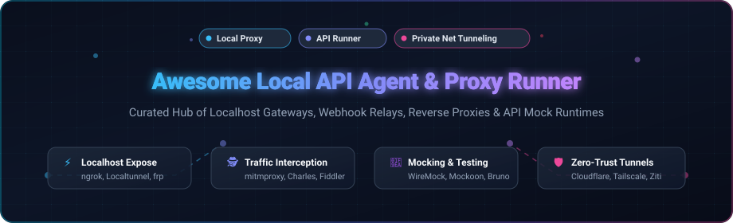
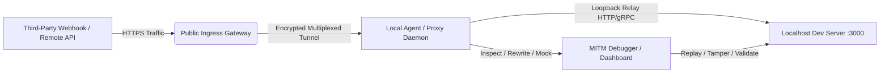

  

<h1 align="center">⚡ Awesome Local API Agent &amp; Proxy Runner 🚀</h1>

  <strong>Curated ecosystem of SaaS platforms, desktop proxies, webhook relays, reverse proxies, and open-source network tunneling runtimes for local API development, debugging, and traffic orchestration.</strong>

  
  
  
  
  
  

---

## 📌 Sector Overview &amp; Market Dynamics

The global **API Management and Secure Access / Ingress Tunneling** market is valued at approximately **$6.2 Billion in 2024** and is projected to surpass **$18.5 Billion by 2030**, growing at an accelerating CAGR of ~20%. The sector exhibits a **moderately fragmented dynamic**: high-scale infrastructure edge players (Cloudflare, Tailscale) anchor enterprise zero-trust networking, while a competitive, high-velocity developer tools layer (Postman, ngrok, Insomnia) captures desktop-to-cloud API lifecycle orchestration, alongside resilient, privacy-centric open-source protocols.

---

## 🏗️ Local API Architecture &amp; Tunnel Flow

---

## 📑 Table of Contents

- [📌 Sector Overview &amp; Market Dynamics](#-sector-overview--market-dynamics)
- [🏢 SaaS &amp; Commercial Hosted Platforms](#-saas--commercial-hosted-platforms)
- [💻 Open-Source GitHub Projects](#-open-source-github-projects)
  - [🌐 Secure Ingress, Edge Tunneling &amp; Multiplexing](#-secure-ingress-edge-tunneling--multiplexing)
  - [🕵️ Traffic Interception, Debugging &amp; Reverse Proxies](#️-traffic-interception-debugging--reverse-proxies)
  - [🧪 API Clients, Mock Servers &amp; Testing Runtimes](#-api-clients-mock-servers--testing-runtimes)
- [🎯 Developer Selection Matrix](#-developer-selection-matrix)
- [🤝 How to Contribute](#-how-to-contribute)
- [💖 Support &amp; Sponsorship](#-support--sponsorship)
- [⭐ Star History](#-star-history)
- [📜 License](#-license)

---

## 🏢 SaaS &amp; Commercial Hosted Platforms

Curated list of leading commercial SaaS platforms, enterprise API agent environments, and managed edge tunnels.

> *Sorted descending by company size (Valuation / Revenue / Scale).*

| Product | Company Size &amp; Valuation | Focus &amp; Core Capabilities | Starting Pricing | Free Tier / Free Trial Limits |
| :--- | :--- | :--- | :--- | :--- |
| **[Cloudflare Tunnel](https://www.cloudflare.com/products/tunnel/)** | **~$40B+** Market Cap (NYSE: NET) • **~$1.6B+** Annual Revenue | Zero-trust edge reverse proxy creating outbound-only connections to Cloudflare CDN, eliminating open firewall ports. | **$7/user/month** (Zero Trust Standard tier with access control rules and audit logging) | **Free Forever plan** with unlimited tunnels, Argo Smart Routing integration, and up to 50 Zero Trust users. |
| **[Postman (Agent Mode)](https://www.postman.com/)** | **~$5.6B** Valuation *(Series D, $433M Raised, Insight Partners)* • **~$150M+** ARR | Desktop and local agent proxy bridging browser-based Postman web client to local HTTP/HTTPS/WebSocket microservices. | **$14/user/month** (Basic plan, billed annually; unlocks unlimited shared collections and mock servers) | **Free Forever plan** with up to 3 team members, full Postman Desktop Agent access, and 1,000 cloud mock calls/mo. |
| **[Tailscale (Funnel)](https://tailscale.com/)** | **~$1.5B–$2B** Valuation *(Series B, $115M Raised, CRV/Accel)* • **~$60M+** ARR | WireGuard-mesh routing with Funnel capability to securely route public internet traffic directly into an individual node. | **$6/user/month** (Starter plan with user role management, custom domain support, and ACL controls) | **Free Forever plan** (Personal plan) supporting up to 3 users, 100 devices, and full Tailscale Funnel access. |
| **[ngrok](https://ngrok.com/)** | **~$250M–$350M** Valuation *(Series A, $50M Raised, Lightspeed)* • **~$30M+** ARR | Developer ingress platform providing instant public URLs, edge TLS termination, OAuth authentication, and webhook verification. | **$8/month** (Personal plan; includes custom static domains and 3 reserved domains) | **Free Forever plan** with 1 online tunnel process, 1 ephemeral domain, 1 GB/mo bandwidth, and 20,000 monthly requests. |
| **[Fiddler Everywhere (Progress)](https://www.telerik.com/fiddler)** | **~$2.5B** Parent (Progress Software - NASDAQ: PRGS) Market Cap • **~$700M+** Revenue | Cross-platform web debugging proxy for HTTP/HTTPS/WebSocket network logging, TLS decryption, request spoofing, and rule-based tampering. | **$12/user/month** (Fiddler Everywhere Pro billed annually at $144/year) | **10-day free trial** with full access to HTTPS traffic decryption, rules builder, and collaboration features. |
| **[Charles Proxy](https://www.charlesproxy.com/)** | **Bootstrapped / Profitable SME** • **~$5M+** Cumulative Revenue | Classic HTTP/HTTPS proxy and reverse proxy enabling developers to intercept traffic, simulate network latency, and rewrite headers. | **$50.00 one-time** commercial license fee per user seat | **30-day free trial** with a 30-minute session execution limit and 10-second startup delay. |
| **[LocalXpose](https://localxpose.io/)** | **Bootstrapped Startup** • **~$1M–$2M** ARR | Reverse proxy client designed to expose local servers to the internet with custom domains, SSL passthrough, and client auth. | **$6/month** (Basic plan; includes 5 concurrent tunnels, 5 reserved subdomains, and 50 GB bandwidth) | **Free Forever plan** with 1 concurrent tunnel, 15-minute connection timeout limit, and ephemeral random subdomains. |

---

## 💻 Open-Source GitHub Projects

Explore the most capable open-source reverse proxies, local API debugging runtimes, mock engines, and network tunnels.

> *Sorted descending by GitHub Stars_Count.*

### 🌐 Secure Ingress, Edge Tunneling &amp; Multiplexing

- **[fatedier/frp](https://github.com/fatedier/frp)**   
  High-performance reverse proxy written in Go that exposes local network services behind NAT or firewall to the internet via TCP, UDP, HTTP, and HTTPS.

- **[tailscale/tailscale](https://github.com/tailscale/tailscale)**   
  The easiest, most secure way to use WireGuard and 2FA to create private overlay networks across workstations, containers, and localhost relays.

- **[localtunnel/localtunnel](https://github.com/localtunnel/localtunnel)**   
  Simple and lightweight Node.js CLI to expose local HTTP ports to a public URL for seamless webhook development and device testing.

- **[snail007/goproxy](https://github.com/snail007/goproxy)**   
  High-performance full-featured proxy supporting HTTP, HTTPS, SOCKS5, Shadowsocks, TCP/UDP port forwarding, and intranet penetration.

- **[jpillora/chisel](https://github.com/jpillora/chisel)**   
  Fast TCP/UDP tunnel over HTTP secured via SSH, packaging both client and server into a single cross-platform Go binary.

- **[cloudflare/cloudflared](https://github.com/cloudflare/cloudflared)**   
  Open-source client daemon for Cloudflare Tunnel connecting local servers directly to Cloudflare edge edge network over QUIC/HTTP2.

- **[rapiz1/rathole](https://github.com/rapiz1/rathole)**   
  Lightweight and secure reverse proxy implemented in Rust for NAT traversal with high throughput and minimal memory footprint.

- **[openziti/ziti](https://github.com/openziti/ziti)**   
  Zero-trust programmable overlay network platform delivering identity-authenticated, encrypted tunneling without inbound open ports.

- **[inlets/inletsctl](https://github.com/inlets/inletsctl)**   
  Automation CLI that provisions Cloud exit nodes across digital cloud providers to host self-managed tunnels with automated TLS certificates.

---

### 🕵️ Traffic Interception, Debugging &amp; Reverse Proxies

- **[mitmproxy/mitmproxy](https://github.com/mitmproxy/mitmproxy)**   
  Interactive, SSL/TLS-capable intercepting proxy for HTTP/1, HTTP/2, HTTP/3, and WebSockets with Python scripting and live web GUI.

- **[Shopify/toxiproxy](https://github.com/Shopify/toxiproxy)**   
  TCP proxy engineered by Shopify for simulating chaotic network conditions, latency, packet drops, and bandwidth throttling on local APIs.

- **[httptoolkit/httptoolkit](https://github.com/httptoolkit/httptoolkit)**   
  Beautiful open-source tool for zero-configuration HTTP/HTTPS interception, real-time request mocking, and mobile device inspection.

---

### 🧪 API Clients, Mock Servers &amp; Testing Runtimes

- **[hoppscotch/hoppscotch](https://github.com/hoppscotch/hoppscotch)**   
  Lightweight, web-based open-source API development ecosystem supporting local proxy agents, REST, GraphQL, and WebSocket dispatching.

- **[usebruno/bruno](https://github.com/usebruno/bruno)**   
  Fast and Git-friendly desktop API client that runs directly against local endpoints without forced cloud synchronization.

- **[Kong/insomnia](https://github.com/Kong/insomnia)**   
  Open-source API client and local mock design platform for GraphQL, REST, WebSockets, and gRPC with configurable proxy settings.

- **[mockoon/mockoon](https://github.com/mockoon/mockoon)**   
  The easiest and quickest way to run local mock REST APIs with automated TLS, proxy recording, rules evaluation, and CLI integration.

- **[wiremock/wiremock](https://github.com/wiremock/wiremock)**   
  Flexible tool for mocking HTTP APIs with dynamic response templating, proxy forwarding, fault injection, and stateful verification.

- **[mock-server/mockserver](https://github.com/mock-server/mockserver)**   
  Comprehensive mock server and proxy client enabling mock responses, verification of sent requests, and upstream proxy recording.

---

## 🎯 Developer Selection Matrix

| Scenario / Use Case | Recommended Solution | Rationale |
| :--- | :--- | :--- |
| **Rapid Webhook Ingress (Stripe / GitHub / Shopify)** | **ngrok** / **Localtunnel** / **frp** | Instant HTTPS URL routing with zero router or firewall reconfigurations. |
| **Deep TLS Decryption &amp; API Tampering** | **mitmproxy** / **Fiddler Everywhere** | Comprehensive packet inspection, Python extension scripts, and breakpoint debugging. |
| **Enterprise Zero-Trust Internal Relay** | **Cloudflare Tunnel** / **Tailscale** | Identity-aware authentication, no open ingress ports, and WireGuard mesh security. |
| **Resilience &amp; Chaos Engineering** | **Toxiproxy** | Programmatic latency injection, bandwidth limits, and connection drops during integration tests. |
| **Offline-First API Design &amp; Mocking** | **WireMock** / **Mockoon** / **Bruno** | Fast local mock responses without external dependencies, with Git-friendly configuration. |

---

## 🤝 How to Contribute

Contributions are welcome! Please follow these guidelines:

1. 🍴 Fork the repository.
2. 📝 Add or update entries in [README.md](file:///C:/Users/hp/Documents/Projects/Awesome-Local-API-Agent-Proxy-Runner/README.md) adhering to the tabular SaaS format or categorized open-source list.
3. ⭐ Ensure all open-source additions include valid Stars_Count badges linking to `stargazers`.
4. 🔗 Verify that all URLs, pricing tiers, and limits are accurate.
5. 🚀 Submit a Pull Request with a clear description of your additions.

---

## 💖 Support &amp; Sponsorship

Thank you for exploring and using this repository! If you find this curated collection helpful for your developer workflows, local debugging, or open-source infrastructure, please consider supporting the project:

- ⭐ **Star this repository** on GitHub to show your appreciation and help fellow developers discover it.
- 🔀 **Fork &amp; Share** it with your engineering team, DevOps peers, and developer communities.
- ☕ **Buy me a coffee / Sponsor**: You can sponsor ongoing curation, maintenance, and updates via the [GitHub Sponsor Dashboard](https://github.com/sponsors/ishandutta2007).

---

## ⭐ Star History

---

## 📜 License

Distributed under the MIT License. See [LICENSE](file:///C:/Users/hp/Documents/Projects/Awesome-Local-API-Agent-Proxy-Runner/LICENSE) for more details.

---

  <strong>Built with ⚡ for developers, security researchers, and backend engineers.</strong>

